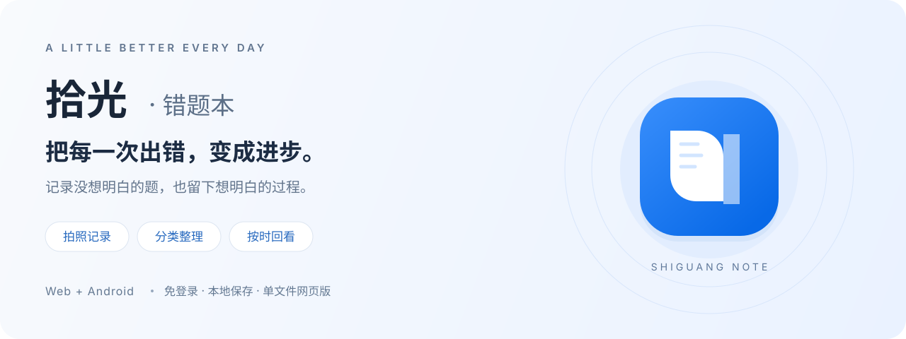

  

<h1 align="center">拾光 · 错题本</h1>

  收集没想明白的题，在回看中找到答案。 
  一款面向学生的错题整理工具，支持拍照记录、分类归因和按时间复习。

  <strong>
    <a href="https://xinhangreat.github.io/Shiguang-Note/">立即在线使用 →</a>
    &nbsp; · &nbsp;
    <a href="https://github.com/xinhangreat/Shiguang-Note/releases/download/V.1.2.0/index.html">下载单文件网页版</a>
    &nbsp; · &nbsp;
    <a href="https://github.com/xinhangreat/Shiguang-Note/releases/download/V.1.2.0/shiguang-1.2.0.apk">下载安卓 APK</a>
  </strong>

  免登录 &nbsp; / &nbsp; 本地保存 &nbsp; / &nbsp; Web + Android 
  <a href="#开始使用">使用指南</a> · <a href="#从记录到复习">功能介绍</a> · <a href="https://github.com/xinhangreat/Shiguang-Note/releases">版本更新</a> · <a href="https://github.com/xinhangreat/Shiguang-Note/issues">问题反馈</a>

---

## 开始使用

**当前发布版本：v1.2.0 · 2026-10-19**

| 使用方式 | 适合的场景 | 入口 |
| :--- | :--- | :--- |
| **在线网页版** | 打开浏览器即可记录，无需注册 | [打开拾光](https://xinhangreat.github.io/Shiguang-Note/) |
| **单文件网页版** | 保存一份到自己的设备，HTML、样式和脚本均已内嵌 | [下载 index.html](https://github.com/xinhangreat/Shiguang-Note/releases/download/V.1.2.0/index.html) |
| **安卓 App** | 在手机上拍照、整理和复习错题 | [下载 shiguang-1.2.0.apk](https://github.com/xinhangreat/Shiguang-Note/releases/download/V.1.2.0/shiguang-1.2.0.apk) |

网页版下载后，用浏览器打开 `index.html` 即可使用；无需安装开发环境或下载其他前端文件。安卓用户下载 `.apk` 文件后，按手机提示安装。

需要其他版本？前往 [全部发布版本](https://github.com/xinhangreat/Shiguang-Note/releases)。请在发布页的 **Assets** 中选择 `index.html` 或 `.apk`；`Source code` 压缩包是仓库文件打包。

## 从记录到复习

### 01 · 先把问题留下来

从首页启动相机，也可以从相册上传或手动记录。拍摄后裁切题目区域，向左或向右旋转照片，把无关内容留在画面之外。

### 02 · 给每一道错题找到位置

按学科或自定义收藏夹整理，再记录错误原因、思路与反思。除了知道“错了什么”，也记下“为什么会错”。

### 03 · 在合适的时间，再看一遍

用日、周、月时间轴回看积累；按天查看时，可以按小时找到记录。进入收藏夹后，按时间或错误原因继续筛选，掌握后标记复习状态。

| 功能 | 可以做什么 |
| :--- | :--- |
| **灵活的收藏夹** | 自定义添加、改名和删除；删除时可把题目移到其他收藏夹或未分类，保留照片与笔记 |
| **九门学科快捷添加** | 语文、数学、英语、物理、化学、生物、历史、政治、地理；已经添加的学科自动从快捷列表隐藏 |
| **照片裁切与旋转** | 调整题目范围，支持向左、向右旋转 |
| **错误原因归类** | 按计算失误、马虎等原因整理，回顾容易反复出错的地方 |
| **题目导出为图片** | 照片下方附带题目名称、分类、错误原因、时间、复习状态和笔记；长笔记可分成多张图片 |
| **自己的鼓励话语** | 在设置中编辑首页轮换话语；导出的题目图片会随机选取其中一句作为页脚 |
| **完整存档** | JSON 存档包含错题照片、笔记、收藏夹、自定义话语和轮换设置；没有题目也可以备份 |
| **随时查看更新** | 页面底部可查看版本更新记录 |

## 第一次记录，只需三步

1. **拍下来**：点击首页相机按钮拍照，或从相册上传，裁切并调整方向。
2. **整理好**：选择收藏夹，填写错误原因、题目名称和自己的思考，保存记录。
3. **再回看**：通过学科收藏或时间轴找到题目，继续补充笔记，掌握后更新复习状态。

想按自己的方式整理？在“学科收藏”中使用“记录错题”旁的收藏夹管理入口，新建“期中复习”“易错公式”等收藏夹。

## 数据与备份

**无需账号，记录保存在当前浏览器或安卓 App 中。** 网页端和安卓端提供对应功能，数据通过 JSON 存档手动迁移，不会自动跨设备同步。

| 要做的事 | 操作 |
| :--- | :--- |
| 给当前记录留一份备份 | 打开存档管理，选择“导出备份”，保存生成的 `.json` 文件 |
| 换设备、换浏览器或切换 Web / App | 先在原设备导出，再在目标设备选择“从备份恢复”并导入 |
| 只带走一道题目及其笔记 | 打开题目详情，选择“导出图片” |

清除浏览器数据或卸载 App 会删除本地记录，请定期导出存档。导入新版存档时会恢复存档内的话语设置，也支持旧版拾光存档。

## v1.2.0 更新亮点

- 收藏夹可以自定义添加、改名和删除，支持九门学科快捷添加。
- 删除收藏夹时可迁移题目，保留照片和笔记。
- 导出图片页脚随机使用自定义话语，长句自动换行。
- 存档包含收藏夹、自定义话语及轮换设置，支持空记录备份。
- 网页版以单个 `index.html` 交付，页面底部可查看更新记录。

[查看本次发布说明 →](https://github.com/xinhangreat/Shiguang-Note/releases/tag/V.1.2.0)

## 常见问题

<strong>需要登录或注册账号吗？</strong>

不需要。打开网页版或安卓 App 即可开始使用，记录保存在当前设备对应的浏览器或 App 中。

<strong>网页版和安卓端的记录会自动同步吗？</strong>

不会自动同步。可以通过“导出备份 → 从备份恢复”在两端手动迁移记录。在线网页版、下载的 HTML 文件和不同浏览器，也应视为不同的存储环境；切换前先导出备份。

<strong>单文件网页版无法启动相机怎么办？</strong>

相机权限取决于浏览器和打开方式。可以改用“从相册上传”，或使用在线 HTTPS 网页版并允许相机权限。

<strong>导出的题目图片和 JSON 存档有什么区别？</strong>

题目图片适合保存、查看和打印某一道题及其笔记；JSON 存档用于备份和恢复记录、收藏夹及话语设置。需要迁移数据时请选择 JSON 存档。

<strong>English overview</strong>

**Shiguang Note** is a login-free mistake notebook for students, available on the web and Android. Capture and crop question photos, organize them into subject or custom folders, record why mistakes happened, and review them by day, week, or month.

Export questions with notes as images, personalize encouraging quotes, and transfer records with JSON backups. Data stays in the current browser or app; cross-device transfer is manual. The downloadable web version is a self-contained `index.html`.

[Try the web app](https://xinhangreat.github.io/Shiguang-Note/) · [Download v1.2.0](https://github.com/xinhangreat/Shiguang-Note/releases/tag/V.1.2.0)

## 反馈与建议

遇到问题或有新的想法，欢迎 [提交 Issue](https://github.com/xinhangreat/Shiguang-Note/issues)。描述问题时，请附上使用版本、设备或浏览器、操作步骤与预期结果；截图中如有个人信息，请先遮挡。

---

  <strong>把每一次出错，变成进步。</strong> 
  A little better every day.

